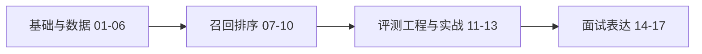

# Learn Note Recsys · 小红书笔记推荐学习项目

**面向大厂搜广推算法面试：公开Qilin数据、召回排序、评测协议与项目表达。**

建议先跑轻量基线，再读[请求级源码](docs/04-source-walkthrough/README.md)和[ItemCF 手算](docs/07-recall/README.md)。用 `python3 scripts/coverage_lab.py` 区分候选缺失和排名问题；[评测章](docs/11-evaluation/README.md)结合 Qilin toy 实测，解释为什么「给定日志候选」和「全训练目录」的 Recall 相差很大。

沿用 [learn-nanobot](https://github.com/bcefghj/learn-nanobot) 的分章节学习形式，内容围绕笔记推荐重新编写。主线是 [Qilin官方数据与baseline](https://github.com/RED-Search/Qilin)，工程阅读参考 [Rednote-Qilin-Search-Rec-System](https://github.com/WBoxian/Rednote-Qilin-Search-Rec-System)。

这是公开数据个人学习项目，与小红书官方线上系统无关联。项目不复制上游完整实现，也不继承作者实验成绩。

## 当前状态

| 内容 | 状态 |
|---|---|
| 17章教程、源码导读、面试和简历模板 | 已提供 |
| 热门/ItemCF、请求级评测、原创样例 | 已运行测试 |
| Qilin官方toy CSV转换 | 已实际验证 |
| 完整Qilin parquet接入 | 适配入口已提供，完整数据未验证 |
| 双塔、DeepFM/DIN、多目标、在线系统 | 源码导读与待完成实战，未声称训练部署 |
| 官方benchmark或线上收益 | 尚未复现，无个人成绩数字 |

## 学习路线



## 章节目录

| 章节 | 阅读入口 |
|---|---|
| 01 | [推荐基础与笔记信息流目标](docs/01-recsys-basics/README.md) |
| 02 | [项目选择：Qilin主线与辅助资源](docs/02-project-selection/README.md) |
| 03 | [离线训练、在线服务与数据流](docs/03-architecture/README.md) |
| 04 | [源码阅读路线与关键检查点](docs/04-source-walkthrough/README.md) |
| 05 | [Qilin字段、数据划分与泄漏防护](docs/05-data-protocol/README.md) |
| 06 | [轻量运行与真实数据接入](docs/06-quickstart/README.md) |
| 07 | [热门、ItemCF与多路召回](docs/07-recall/README.md) |
| 08 | [双塔召回与负采样](docs/08-two-tower/README.md) |
| 09 | [排序：LR、DeepFM与DIN](docs/09-ranking/README.md) |
| 10 | [多目标、重排与冷启动](docs/10-multitask/README.md) |
| 11 | [全库召回、候选重排与偏差](docs/11-evaluation/README.md) |
| 12 | [服务化、版本包与故障降级](docs/12-serving/README.md) |
| 13 | [三阶段实战与实验矩阵](docs/13-project-labs/README.md) |
| 14 | [高频问题与连续追问](docs/14-interview/README.md) |
| 15 | [搜广推能力映射与简历](docs/15-role-and-resume/README.md) |
| 16 | [项目陈述与失败复盘](docs/16-star/README.md) |
| 17 | [资料索引与阅读顺序](docs/17-resources/README.md) |

## 五分钟开始

```bash
python3 scripts/demo.py
python3 -m unittest discover -s tests -v
```

无需GPU或第三方包。合成数据仅检查流程；真实数据入口见[第06章](docs/06-quickstart/README.md)，评价口径务必读[第11章](docs/11-evaluation/README.md)。

```text
docs/          17章中文教程
projects/      实践入口
scripts/       数据转换、基线、指标与参考下载
data/sample/   原创合成请求
experiments/   软件验证记录与实验模板
tests/         指标、时间隔离与转换器测试
```

完整来源版本见[SOURCES.md](SOURCES.md)，检查结果见[VALIDATION.md](experiments/VALIDATION.md)。建议与learn-meme-search配合，在六周内完成基础、实验与面试复盘。

原创内容采用[MIT许可](LICENSE)。上游代码、数据、模型保留各自许可，不将原始日志、内容图片或模型权重上传本仓库。
