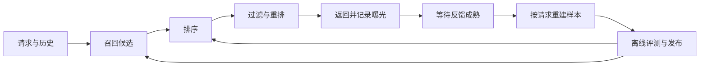
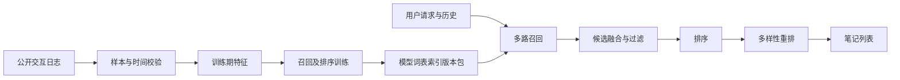

# 03 · 离线训练、在线服务与数据流

## 用一条曝光还原离线和在线

用户在 14:00 打开首页，已有「徒步鞋」「周末短途」两条历史。14:00:01 候选里出现一条「雨天徒步装备」，14:00:04 点击。对于当次排序，历史和笔记元数据要从 14:00 前的快照读取；14:00:04 只能产生标签。若一张训练宽表直接联全量行为表，用户点击次数、笔记流行度乃至历史序列都可能含这次行为。模型离线作弊，上线时这个信息还没有发生。

召回用可独立计算的用户和笔记表示，规模上适合近似搜索。排序只看召回的候选，可以加入「最近历史和候选笔记的匹配」这类交叉特征。重排看列表：前五条来自同一作者，可能单条都好、合在一起却重复。工程上分别记录请求 ID、候选来源、过滤原因、打分版本和展示的位置，才能回溯是哪一层丢掉了目标。见[第 11 章](../11-evaluation/README.md)。

### 复盘题

新笔记刚发布，召回阶段就不在目录里；精排在这条笔记上的 AUC 能说明该问题吗？不能。先跟踪可服务目录的更新时间和未入目录比例，再给新笔记接内容召回或受控探索。只有候选进入排序，它才有机会被提到前面。

离线阶段产出用户/物品ID映射、模型、物品向量、索引、特征定义和统计截止时间。在线阶段必须使用同一份映射和预处理；只同步模型权重不足以保证正确。

建议从单机文件构建起步。只有需要多人演示或持久业务状态时再加入Redis、数据库和API。上游完整系统可作为阅读样本，本仓库当前提供CLI实验链路。

一次请求的日志至少包含request_id、user_id、模型版本、候选各通道来源、过滤计数、分阶段延迟和最后返回ID。曝光与点击记录分离，避免把“接口返回”当作用户实际看到。

验收：模拟词表版本不一致，说明为什么模型会把同一ID解释成另一篇笔记；画出失败回滚到热门推荐的流程。

---
[返回首页](../../README.md) · [上一章](../02-project-selection/README.md) · [下一章](../04-source-walkthrough/README.md)
