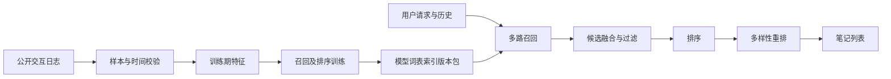

# 03 · 离线训练、在线服务与数据流

离线阶段产出用户/物品ID映射、模型、物品向量、索引、特征定义和统计截止时间。在线阶段必须使用同一份映射和预处理；只同步模型权重不足以保证正确。

建议从单机文件构建起步。只有需要多人演示或持久业务状态时再加入Redis、数据库和API。上游完整系统可作为阅读样本，本仓库当前提供CLI实验链路。

一次请求的日志至少包含request_id、user_id、模型版本、候选各通道来源、过滤计数、分阶段延迟和最后返回ID。曝光与点击记录分离，避免把“接口返回”当作用户实际看到。

验收：模拟词表版本不一致，说明为什么模型会把同一ID解释成另一篇笔记；画出失败回滚到热门推荐的流程。

---
[返回首页](../../README.md) · [上一章](../02-project-selection/README.md) · [下一章](../04-source-walkthrough/README.md)
