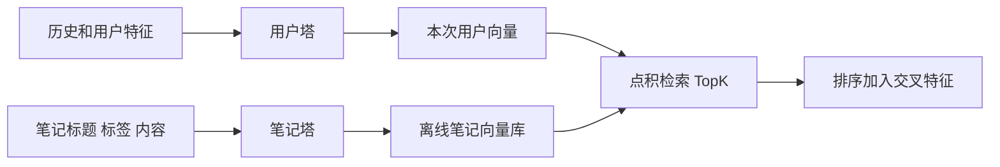

# 08 · 双塔召回与负采样

## 为什么塔的两边不能互相偷看



如果给笔记塔加「当前用户是否点过该作者」，每个用户都要重算库。原本一次夜间编码 100 万条，可以重复服务所有请求；加入交叉项后变成每个请求都要算，失去检索架构的主要价值。将这个信号移动到排序，或事先构造用户对作者偏好的向量化表示，再看首阶段能不能维持必要的可分解形式。

## 会算矩阵，也要检查列 ID

```text
批内正配对：(U1, A)，(U2, B)，(U3, A)
               V_A  V_B  V_A
          U1 [  +    -    + ]   A 重复出现，两列都是正例
          U2 [  -    +    - ]
          U3 [  +    -    + ]   对角标签会误把另一列 A 当负
```

可为每行构造 item_id 等值掩码，将多正例的指数分数加到分子；也可在采样侧控制冲突。直接平均所有正例的单独交叉熵与先汇总概率质量不是同一目标，二者如何处理重复计数也不同。先用打印的小样例确认目标概率定义，再改大型训练。

### 逐级可交付的实现计划

1. 先用简单 ID embedding 在小训练子集里拟合，不接 ANN；看 batch 能不能 overfit、loss 是否下降。对完全未知的 ID 不给虚假的学习效果。
2. 此时有 ID 但没覆盖新笔记，加入文本主题或标题等可用时点特征，并在测试期新笔记切片上独立评估。
3. 验证输入与输出稳定后，固定向量库，测精确点积。另做近似搜索以量化索引损失。
4. 与热门、ItemCF 用同一数据切分、同一个可服务目录、同样的 K 比较。在报告里列训练负采样与测试候选，不把 batch 的准确率当线上 Recall。

<details>
<summary>练习：如果 batch 只选同主题的笔记，会得到什么？</summary>

模型看到的竞争项更难，可能更能区分近似内容；也可能把用户潜在会喜欢的同类笔记当假负例。除配对正确率外，要看独立负样本、语义题和同目录结果，对照混合采样才能说明收益。
</details>

## 两座塔分别负责什么

用户塔编码历史、近期兴趣、场景，得到向量 $u$。笔记塔编码标题、标签、作者和可选图像，得到向量 $v$。线上用 $u^Tv$ 搜候选，笔记侧可预编码并做向量索引；这就是双塔与深度交互排序模型的资源差别。如果把「这个用户对该笔记作者近一周的点击次数」直接放进笔记塔，那向量会随用户变，无法做全库预计算。可以把该交叉特征挪到精排。

同批 B 个点击配对，计算 $B\times B$ 分数矩阵。某行正例分为 2、另两个分为 1 和 0，softmax 目标概率 $e^2/(e^2+e+1)\approx0.665$，交叉熵约 0.408。若同一笔记在批中重复出现，列索引不同但语义上是同一正例；把非对角线全当负例会把它同时往两个方向推。应按笔记 ID 建掩码，或设定不重复的采样规则，并记录正例碰撞率。

## 负采样不是一个入口参数就完事

- 随机库内样本多数很容易，能学粗粒度兴趣，对区分同类笔记可能帮助小。
- 展示未点的笔记更贴近候选侧，旧策略和位置会决定你看到了哪些负例。
- 取检索靠前却未点击的作为困难负例时，先排除已知正例和同内容版本，并观察采样是否压制有用的长尾。
- 批内负例跟随训练数据中的物品频率，热门重复多。如果引入采样概率修正，要用实际采样分布，说明目标与采样策略一起改动；不能把修正项当万能的曝光偏差解决方案。

训练后先用精确 TopK 验证模型本身，再换 ANN 看索引损失。多份指标至少应包括：全可服务目录候选 Recall、精确与 ANN 的 TopK 重合、用户空历史/新笔记分组、延迟和存储。当前仓库没有训练器和 ANN；本章是实现与验收路线。做最小双塔时，用训练期出现的 ID/标签特征先验证损失能下降，同时明确只用 ID 的新笔记没有有意义的 embedding，要靠内容特征。

练习：训练损失持续下降，测试 Recall 却下降，如何排查？先检查离线准确候选目录、查询时点和 ID 映射；再用简单的固定训练子集验证模型能拟合；最后比较假负例、过拟合和训练负例分布与测试的差异。若精确检索指标正常而 ANN 掉，定位索引配置比换模型更直接。

用户塔编码历史、画像和上下文为u，物品塔编码ID、类目及内容为v，用内积打分。物品侧可离线建索引，用户塔在线生成查询向量。用户塔不应包含当前候选特有特征，否则无法一次生成全库检索向量。

训练可用批内负样本的softmax对比损失。随机负例便宜但可能太容易；曝光未点负例更接近排序任务，但带历史策略与位置偏差；困难负例需排除真正相关的假负例。

如果负例按流行度q(i)采样，训练分布与目标全库分布不一致。log-q修正适用于相应采样目标与实现前提，不能看到任何负采样就机械减log-q。先写清概率分布，再推导目标。

## 可复现训练顺序

先固定内容池和请求划分，建立热门/ItemCF结果；实现ID双塔，再加入内容特征；每次只加一个信号。导出物品向量后，用同一查询比较精确Top K与ANN Top K，分别测模型召回和索引近似损失。

本章是进阶实验，本仓库没有自称完成双塔训练。可以沿官方DPR或上游DSSM训练入口复现，但两者输入表示不同，比较时必须保持候选池和数据协议一致。

验收：给出一个批次张量形状、loss正例位置、负例构造、OOV处理，以及更新物品塔后为何要重建全索引。

---
[返回首页](../../README.md) · [上一章](../07-recall/README.md) · [下一章](../09-ranking/README.md)
